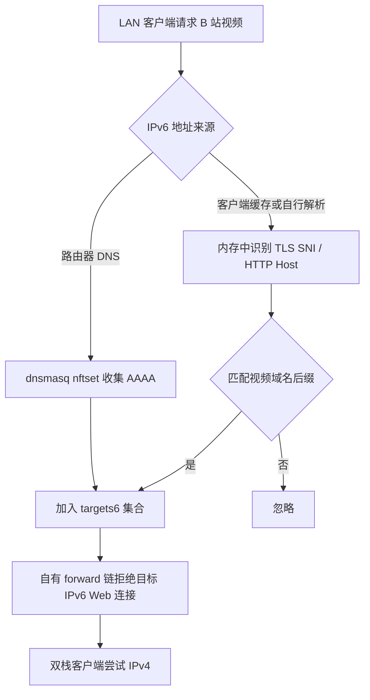

# 工作原理与边界

本服务不修改 DNS 返回的 A/AAAA 内容；它限制的是转发层的目标 IPv6 连接，因此使用客户端缓存地址的请求也可被处理。TCP 使用 reset，QUIC 使用 ICMPv6 port-unreachable，避免无声丢弃导致长时间等待。

`targets6` 仅保存 IPv6 地址，最多 4096 项，默认 1 小时超时。学习器只接收指定 LAN 接口的入站 IPv6 TCP，并检查目标端口、域名后缀边界和报文长度。它支持以太网、VLAN、Linux cooked 格式、连续 TCP 分段拼接，以及大小端 pcap。解析结果只用于地址集合，日志不保存完整请求 URL、Cookie 或媒体内容。

procd 分别管理监测与维护实例。监测使用内存 FIFO；维护每 15 秒检查自有表，每 5 分钟刷新种子域名。发现自有表被删除时会重新建立，并立即重新查询种子地址。停止服务会清空自有转发链，启动时恢复两条规则。

规则条件是指定的 LAN 入接口、目标地址集合及 Web/视频端口。它不会修改路由、VLAN、接口、现有 fw4 表或 Open-Box 配置；与 `xhs-ipv4` 的服务、集合、DNS 标记及备份路径分开。

由于最终按 IP 限制，共享 CDN 地址可能使同地址其他站点也改走 IPv4。TLS ECH、QUIC 中未从 DNS 学到的地址、不在覆盖范围的端口、新协议、其他 LAN 桥或不经过此路由器的流量都可能漏识别。方案依赖客户端具备正常的 IPv4 通路，属于绕行措施，不修复底层 IPv6 故障。
